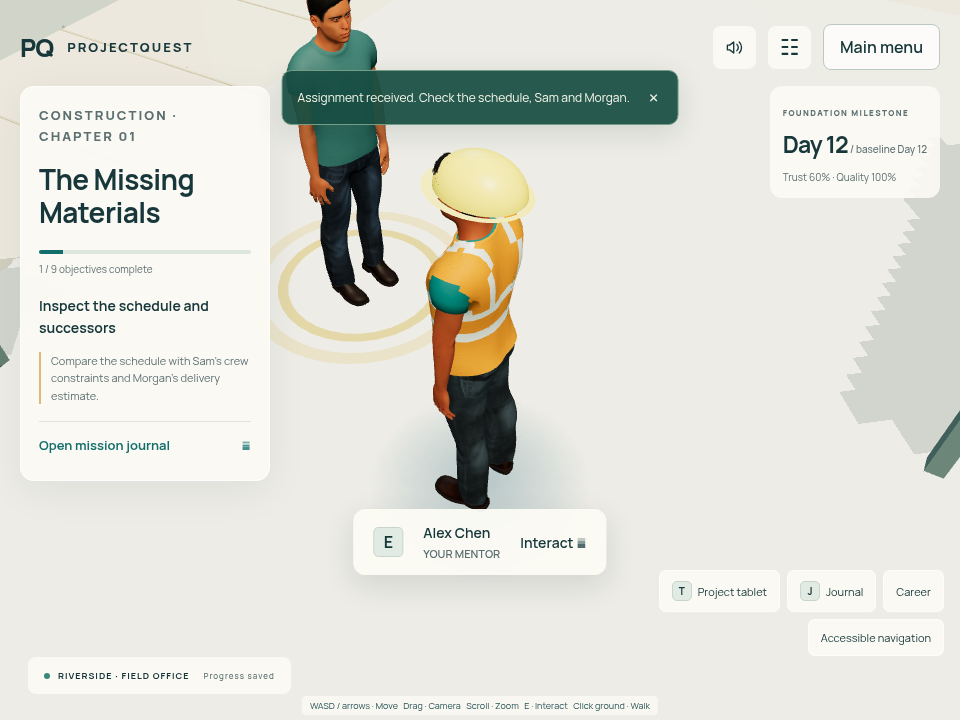

# Human character system

The player and all four NPCs use actual textured, weighted human meshes. The old primitive-body character constructor has been removed. The same male/female anatomical bases, materials and skeletal-animation system support every workplace style; no character is a flat picture or billboard.

## Runtime and appearance

`src/world/humans.ts` loads the bundled binary glTF assets once per scene library. Geometry and textures are shared across actors, while each actor has its own skeleton, cloned materials and animation mixer. Independent rigs prevent one person's movement from deforming another person. Colour changes preserve skin, fabric and hair detail rather than replacing textured surfaces with flat geometry.

`WorldCanvas` retains the existing collision radius, world positions, pathfinding, proximity checks, NPC target IDs, dialogue and mission commands. Authored in-place Idle and Walk clips blend according to actual movement; walking into a wall returns to idle. The gameplay root remains responsible for translation and turning. Reduced motion holds a natural idle pose. Paused tools freeze their 3D backdrop. Dynamic humans use contact grounding rather than casting a frozen pose into the scene's baked shadow map.

Both body types are selectable in character creation. The preview renders the same 3D assets, with full-body, face and hand views and accessible rotation controls. Existing skin/workwear/hair colour choices remain functional. Body type is an optional saved appearance field: original saves omit it and retain the masculine build, with their original project history and scores unchanged.

Dragging still orbits the third-person camera; scrolling adjusts its distance within bounded limits. The default camera distance is retained. All project-management tools and both construction assignments remain intact.

## Workplace wardrobe

| Shared style | Clothing |
| --- | --- |
| Construction / Infrastructure | Fitted work shirt and denim/work trousers, sturdy shoes, high-visibility vest and optional formed hardhat |
| Software / office | Textured casual shirt and trousers, ordinary shoes, no site PPE |
| Healthcare | Separate V-neck scrub top and scrub trousers, pocket and drawstring, clinical footwear colours |
| Events | Dark coordinated shirt, trousers and shoes |
| Manufacturing / Operations | Work separates, high-visibility vest and optional head protection |
| Energy / Sustainability | Work separates, high-visibility vest and optional head protection |

These are reusable wardrobe configurations in the shared character library. Construction remains the only playable industry; adding clothing styles does not implement the other industry campaigns. NPCs in the site area wear PPE, while office colleagues use ordinary workwear. New content should choose an existing style rather than clone the renderer.

## Loading, optimisation and ownership

The scene becomes ready only after both models have loaded and validated weighted skinning and required animations. A failed download shows a retry action and the existing accessible workplace route; it never silently falls back to the block characters. Cancellation and unmounts dispose private mixers, materials and skeletons, followed by shared GPU geometry, all texture slots and image bitmaps. Preview and world resources have separate ownership.

The assets contain a bounded number of triangles, a compact game rig and locally bundled textures; final per-file statistics are stored beside the GLBs. No model hosting service or runtime character-generation API is required. The character preview caps rendering at 30 frames per second and pauses unnecessary background work. The main scene keeps its low-graphics option and software-renderer detection. These engineering measures are not a minimum-device FPS guarantee.

## Asset sources and authoring

The anatomical mesh, morph targets, rig/weights, eyes, hair, clothing and textures originate in MakeHuman / MPFB's CC0 asset ecosystem. Their source/output licence is distinct from the GPL-licensed Blender add-on used as an authoring tool. See the bundled model notices and upstream asset licence for exact provenance. The game does not distribute the MPFB program code or require Blender to play.

The original source is the [MPFB2 project](https://github.com/makehumancommunity/mpfb2). Its [licensing explanation](https://github.com/makehumancommunity/mpfb2/blob/master/LICENSE.md) explicitly identifies base meshes, targets, textures, clothing, rigs and poses as CC0 and states that generated output has no usage restriction. The system assets used for the clothing/skin exports were obtained from the legitimate [Makehuman-2 CC0 asset-pack release](https://github.com/Makehuman-2/MH2_Asset_Repository_CCO/releases/tag/CC0); individual source files retain their explicit September 2020 CC0 notices and credit Data Collection AB, Joel Palmius and Jonas Hauquier. MakeHuman community contributors are credited in the upstream asset files.

ProjectQuest's exporter, in-place animation poses, PPE geometry and clinical garment adaptations are authored for this project. `scripts/characters` preserves the conversion recipe. Rebuilding assets is optional; developers normally install/run the game using the committed GLBs. The source licensing notices accompany the derived assets. Refer to the authoring instructions for exact preparation commands and dependencies.

## Verification and current limits

Unit checks validate independent skeletons/materials, animation blending, cancellation, failure handling, shared-resource disposal and actual GLB structure. Browser checks inspect real skinned meshes, live appearance changes, saved body type, idle/walk transitions, collision, camera movement, NPC dialogue and asset failure/retry. Existing Day 1 and Day 2 acceptance checks remain regression gates. Face, hands and full-body screenshots are inspected inside the browser rather than treating a successful build as visual approval.

These are semi-realistic game characters using two base human builds and colour/outfit variation. They do not yet provide facial performance capture, lip sync, a large face/hair editor, cloth simulation or a large collection of independently sculpted identities. Representative-device benchmarks and broader production character art remain future work. Verification results for the delivered revision are recorded in [verification.md](verification.md).

## Captured browser evidence

These captures use the actual bundled meshes in Chromium, including the corrected outward-facing hardhat. They are engineering review captures, not external reference art.

[Face detail](media/characters/female-face.png) · [Anatomical hands](media/characters/female-hands.png) · [Full body and clothing](media/characters/female-full-body.png)
