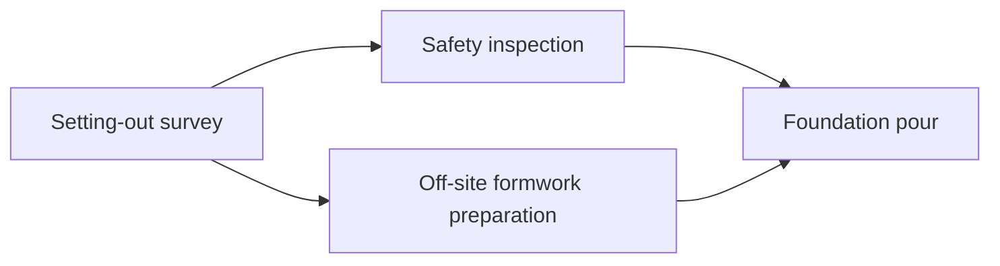

# Mission content and systems guide

The [GDD](design/ProjectQuest_Comprehensive_Game_Design_Document.docx) is the product specification. Its Day 1 definition of done and escalation rubric drive the first playable content. All project dates, costs and consequences are fictional teaching values; they are not engineering estimates, legal advice or certification evidence.

Two construction chapters are playable: Day 1 establishes evidence-based escalation; Day 2 introduces a working dependency schedule. [verification.md](verification.md) records completed validation and delivery evidence. Other industries and Day 3 onward remain planned content. All durations, costs and branch outcomes below are authored balancing assumptions awaiting subject-matter review.

## `CONST-I01` — The Missing Materials

**Placement:** Junior PM Intern, construction site office, two-storey community building project. **Goal:** Provide grounded concrete-delivery status and a next-step recommendation before the coordination meeting. **Authority:** Inspect, ask, update records and recommend. The intern cannot approve a new supplier, commit expenditure, waive safety review or silently change the baseline.

### Cast and sources

| Source / character                   | Distinct contribution                                                                               | Uncertainty / authority                                                                                         |
| ------------------------------------ | --------------------------------------------------------------------------------------------------- | --------------------------------------------------------------------------------------------------------------- |
| Project schedule at planning board   | Foundation task, baseline dates, finish-to-start successors and affected milestone                  | Approved plan documents sequence, not current supplier readiness                                                |
| Sam, foreman/delivery lead           | Crew booking, dependency timing and practical impact if concrete is late                            | Operational knowledge includes assumptions that require confirmation                                            |
| Morgan, supplier contact at terminal | Truck problem, estimated replacement timing and commitment status                                   | Estimate is probabilistic; no confirmed delivery guarantee                                                      |
| Alex, mentor / Senior PM             | Delegates work, probes confidence and impact, owns approval/review                                  | Can review a recommendation within scenario authority                                                           |
| Taylor, safety/quality coordinator   | Optional fourth conversation explains acceptance, access and approval requirements for an alternate | Already interactive; cannot waive checks; inspecting this source supports stronger alternate follow-up evidence |
| Riley, sponsor                       | Full-week cast for governance, acceptance and pressure scenarios                                    | Planned later character, not an interactive NPC in this slice                                                   |

The sources intentionally conflict in confidence and implication, not by presenting three copies of the same clue. Source inspection is recorded with a stable ID. Repeated reading must not inflate evidence or assessment.

### Objective graph

```text
Meet mentor / receive assignment
               ↓
Inspect schedule + ask foreman + confirm supplier
               ↓
Update source-backed task / issue artefact
               ↓
Prepare recommendation + confidence/impact response
               ↓
Mentor review → explicit time checkpoint → delivery event
               ↓
Project consequences → rubric feedback → saved career record
```

The mission journal displays the next useful action and completed prerequisites. A validation error explains a missing owner or source instead of completing an objective. Dependency awareness is demonstrated through the work, rather than a vocabulary quiz.

### Tool behavior

The portable tablet opens from the board, its toolbar button, or T. Tasks, Schedule and Issue register are semantic keyboard-navigable tabs. The task board allows a source-backed status, blocker and owner update on the concrete delivery card. It rejects completion before a signed receipt and rejects changing Day 1's due date; foundation/framing baselines are protected. The basic schedule makes the delivery → foundations → framing relationship, baseline/forecast and response costs visible. The issue record requires title, known owner, severity, Day 1 due date, inspected evidence, affected work, confidence wording and the agreed 10:30 checkpoint. Required fields and domain errors are readable and preserve the rejected command's canonical state.

The schedule, Sam and Morgan must all be investigated and cited in the issue before a recommendation can be submitted. Taylor is optional for completion. The recommendation form accepts an optional four-value comparison: wait finish day/additional cost and alternate finish day/additional cost. A partial comparison is rejected, and a wrong complete comparison remains logged for explanatory feedback rather than silently being corrected. The highest impact score requires the player to enter Day 13 / +400 and Day 12 / +2,000 respectively and trace the foundation dependency.

No issue is “resolved” merely because it was recorded. Forecast changes come from simulation rules and review, not moving a card for visual effect.

### Decisions and recoverable outcomes

| Response                                                   | Legitimate?                            | Intended operational effect / feedback                                                                                                                                                                                                  |
| ---------------------------------------------------------- | -------------------------------------- | --------------------------------------------------------------------------------------------------------------------------------------------------------------------------------------------------------------------------------------- |
| Wait with a contingency and verification checkpoint        | Yes, when evidence and owner are clear | Default seed: accepted replacement at 10:30 misses the morning pour, Day 13 forecast, +400 standby credits, improved trust/wellbeing. A seeded late-replacement branch produces Day 14 / +800 while preserving honest-escalation credit |
| Recommend alternate supply subject to cost/safety approval | Yes                                    | Alex conditionally approves +2,000 credits; Sam/Taylor verify site access/acceptance at 10:30 before approval becomes effective and spend is recorded; Day 12 forecast and normal quality retained                                      |
| Promise delivery with unsupported certainty                | Professionally unsound                 | Brief confidence can reverse after the event; factual accuracy and honest confidence matter                                                                                                                                             |
| Attempt to order an alternative supplier as an intern      | Governance breach                      | Procurement blocks the order; Day 14 forecast and +800 standby credits reflect disruption, not a committed alternate purchase; authority score fails and reflection/replay remain available                                             |
| Understate or ignore successor impact                      | Incomplete reasoning                   | A recorded issue still misses downstream schedule consequences; review explains dependency tracing                                                                                                                                      |

An unsupported guarantee produces an initially reassuring trust increase, then a dispatch audit: Day 14 forecast, +1,000 disruption credits and trust corrected to 44. Review can also be deferred without inventing a false assurance; this still loses coordination time and reduces performance, while remaining distinct from a governance breach.

Consequences are deterministic and distinguish schedule, cost, quality, wellbeing, trust and governance instead of one opaque “correct” badge. Recovery includes a documented evidence follow-up after a pressured conversation, reflection and replay. Day 1 replay resets that career practice run; continuing to Day 2 retains the actual project outcome. A separate recovery assignment is planned, and no branch grants a promotion.

### Rubric

| Criterion | 0 — Missing         | 1 — Developing         | 2 — Competent                | 3 — Strong                       |
| --------- | ------------------- | ---------------------- | ---------------------------- | -------------------------------- |
| Accuracy  | Misstates facts     | Weak/incomplete source | Accurate sourced status      | Separates fact from assumption   |
| Impact    | No effect explained | Vague concern          | Links schedule/scope/cost    | Compares quantified alternatives |
| Authority | Acts beyond role    | Decision owner unclear | Escalates to right authority | Makes approvable recommendation  |
| Follow-up | No action           | Unowned action         | Owner and due date           | Verification plus contingency    |

Each score cites logged behavior. For strong follow-up on the alternate path, the learner also investigates Taylor's acceptance requirements; the checkpoint then logs the actual review. Operational success, XP, professional conduct and competence remain separate. XP is 40 completion points plus five per rubric point, awarded once in a run; Source Checker, Early Escalator and Recovery Planner have action-based conditions. Novel independent scenarios and diminishing hint use are needed for mastery; a flawless replay alone is insufficient.

## `CONST-I02` — The Slipping Milestone

**Placement:** The next morning on the same construction project, still as Junior PM Intern. **Goal:** Trace an apparently minor setting-out delay through two successor teams, record an evidence-backed working forecast, and recommend a response before 11:00. **Entry:** Complete Day 1 and choose Continue to Day 2 in the debrief. Profile, accumulated XP, relationships, cost, trust, forecast and the first case study carry forward.

### Evidence and working schedule

The approved schedule is required evidence for the baseline and sequence. Sam provides the verified remaining survey duration and owns the 11:00 follow-up. Taylor supplies the release and acceptance constraints. Morgan provides optional capacity context for a second survey team; Day 2 does not require the Day 1 delivery investigation again.

| Work package                  | Baseline duration | Verified duration | Finish-to-start predecessors                               |
| ----------------------------- | ----------------- | ----------------- | ---------------------------------------------------------- |
| Setting-out survey            | 1 day             | 2 days            | None in this planning window                               |
| Safety inspection             | 1 day             | 1 day             | Released setting-out survey                                |
| Off-site formwork preparation | 2 days            | 2 days            | Released setting-out survey                                |
| Foundation pour               | 1 day             | 1 day             | Accepted safety inspection and completed off-site formwork |



Off-site formwork assembly takes place separately from the inspection zone; its parallel planning never waives the inspection. The learning twist is a diamond rather than Day 1's single chain. The learner edits labelled task-duration inputs and predecessor checkboxes in the tablet. The model recalculates task early starts/finishes and critical activities; a plan is accepted only with all four required links, Sam's sourced duration, Sam as owner, the 11:00 check and schedule/Sam/Taylor provenance.

For each task, earliest start is the maximum predecessor finish, then earliest finish is start plus duration. The baseline chain is four working days; the verified chain is five, controlled by survey → formwork → pour. The extra day is added to the actual carried Day 1 forecast. Relative planning days are separate from the checkpoint clock. Saving a plan updates a working forecast; it neither changes the approved baseline nor starts physical work.

### Response, approval and consequence

The learner compares the revised sequence and extra-team estimates, commits a recommendation, records confidence and the next check, then answers Alex's review. A proposal is distinct from approval. Project time advances only through the explicit 11:00 checkpoint.

| Response                                                           | Checkpoint consequence                                                                                                                                    |
| ------------------------------------------------------------------ | --------------------------------------------------------------------------------------------------------------------------------------------------------- |
| Accept the revised sequence with conditional wording and follow-up | One day beyond the carried forecast, no extra spend; Sam notifies both teams and acceptance gates remain                                                  |
| Request a second survey team with conditional wording and approval | Alex conditionally approves 1,200 credits; Sam verifies capacity and Taylor retains acceptance gates before commitment; the carried forecast is recovered |
| Propose skipping inspection                                        | Taylor blocks the bypass; no unsafe work occurs. The coordination setback adds two days beyond the carried forecast and 500 disruption credits            |
| Promise the original date without support                          | The audit compares the promise with the verified dependencies; the setback adds two days and 600 disruption credits, with reduced trust                   |
| Defer review without a clear approved response                     | Coordination slips; a supported recovery remains available through feedback/replay. Two days and 300 credits represent the unresolved follow-up           |

The exact checkpoint also considers confidence wording and the committed mentor answer. Guaranteed wording can turn an otherwise defensible option into an unsupported assurance. Feedback cites the source questions, saved schedule, comparison, review and verified event. The four 0–3 criteria remain accuracy, dependency reasoning, authority and follow-up; XP is 50 completion points plus five per criterion point, awarded once. Dependency Detective records quantified dependency evidence, while the case study preserves the outcome and scores.

Day 2 replay reconstructs the actual Day 1 checkpoint and replaces the Day 2 practice result without stacking rewards. Day 3, **The Stakeholder Check-in**, is planned and cannot be launched from this build. The player remains an intern after both chapters.

## Versioned mission contracts

The Day 1 `IndustryPack` in `src/game/types.ts` has this content shape; `src/game/content.ts` supplies it:

```ts
type IndustryPack = {
  id: "construction";
  title: string;
  mission: {
    id: "CONST-I01";
    version: 1;
    title: string;
    briefing: string;
    authority: string[];
    rubric: string[];
    recovery: string;
    setting: string;
    roleRequired: "intern";
    prerequisites: string[];
    startState: "arrival";
    objectiveIds: string[];
    events: {
      id: string;
      trigger: string;
      minutes: number;
      priority: number;
      once: boolean;
    }[];
    allowedActions: string[];
    outcomes: string[];
    recoveryRoutes: string[];
    reflections: string[];
    acceptanceTests: string[];
  };
  sources: Record<SourceId, Source>;
  npcs: Record<NpcId, Npc>;
  options: Record<
    ProposalOption,
    {
      label: string;
      description: string;
      forecastDay: number;
      cost: number;
    }
  >;
};
```

`Source` contains an ID, title, detail lines and provenance. `Npc` contains an ID, name, role, greeting, evidence response and pressure response. Day 1 `ProposalOption` IDs are `wait`, `alternate`, `promise` and `unauthorised`. `getPack()` returns a copy of this authored pack. Day 2 uses `DAY2` and `baselineSchedule()` from `day2-content.ts`, `ScheduleMissionState`/`SchedulePlan` from `day2-types.ts`, and the pure `calculateSchedule()` model from `schedule.ts`; its options are `wait`, `extra_team`, `bypass` and `original_date`.

`createGame()` owns the initial state, `getObjectives()` and `getFeedback()` route by mission, and `applyCommand()` routes the mission rules through `engine.ts` and `day2.ts`. NPC answers and response choices are journal-backed commitments scoped to the current mission. `followUp` recovers evidence after pressure without changing the answer or restoring its relationship cost. Content strings are not an executable mission editor. Future packs need generic loading and validated predicates before rules can be authored without code. Preserve stable IDs and explicit save compatibility when extracting those contracts.

## Industry pack contract

| Pack component      | Required content                                                                               |
| ------------------- | ---------------------------------------------------------------------------------------------- |
| Setting             | Hub/site scene, interactables, props, readable environment feedback, licensed/owned asset list |
| Roster              | Mentor, sponsor, team, suppliers, goals, information limits, reliability and availability      |
| Mission graph       | Briefings, sources, objective dependencies, events, legitimate options and recovery            |
| Operations          | Calendar, costs, dependencies, procurement/quality/compliance constraints and sector terms     |
| Assessment          | Observable competencies, rubric, misconceptions, feedback and transfer task                    |
| Localisation/review | Jurisdiction labels, translated terms, SME review and safety limitations                       |

Construction's materials/dependency story is not a template answer order for every sector. Software needs defect severity, QA and release pressure; healthcare needs adoption/privacy/service continuity; events need vendor/run-of-show/weather contingency; manufacturing needs shutdown capacity and commissioning; energy needs grid/permit/supply constraints.

## Shared game systems inventory

| System                 | First slice responsibility                                                                                                                          | Later depth                                                                          |
| ---------------------- | --------------------------------------------------------------------------------------------------------------------------------------------------- | ------------------------------------------------------------------------------------ |
| Character and profile  | Name, appearance, intern role, controlled avatar, local resume                                                                                      | Cosmetics, more rigs and profiles                                                    |
| Industry               | Clearly distinguish playable construction and future packs                                                                                          | Transferable skill retention plus sector onboarding                                  |
| World                  | Navigable office/site context, interaction proximity and accessible alternative                                                                     | Multiple hubs, stateful site stages and richer animation                             |
| Dialogue/relationships | Authored evidence questions, mentor review and trust consequences                                                                                   | Availability, preferences, long-term relationships, optional bounded AI              |
| Missions               | Two linked chapters, mission-specific objectives, validated completion and debrief                                                                  | Remaining first-week days, capstones, multi-project campaigns                        |
| Simulator              | Validated four-task finish-to-start graph, recomputed forecast, trade-offs, governance and deliberate events                                        | Resource levelling, calendars, budgets, risk realisation and portfolio rules         |
| Work tools             | Task board, issue record and editable duration/dependency schedule with source provenance                                                           | WBS, full RAID, changes, meetings, procurement and formal status reports             |
| Time                   | Explicit checkpoints, no reading penalty                                                                                                            | Calendar, scheduled meetings, priorities and seeded event variation                  |
| Learning/career        | Four criteria, logged evidence, comparisons, two saved case studies and achievements; accumulated XP remains separate from mastery                  | Full taxonomy, further independent successes, ethical gates and promotion challenges |
| Persistence            | Schema-2 local save, original schema-1 compatibility, chapter resume/replay and no duplicate rewards                                                | Future-version migrations, profiles and opt-in cloud sync                            |
| UI/accessibility       | Contextual HUD, T tablet, semantic focus-managed dialogue/tabs, readable errors/loading, labelled routes and text/contrast/motion/low-spec settings | Remapping, camera sensitivity and documented assistive-device tests                  |

## Authoring and review workflow

Learning design specifies observable evidence first. A practising PM supplies credible constraints and more than one defensible response. Narrative gives each NPC a motive and knowledge boundary. Systems design turns that content into validated commands and causal outcomes. QA checks every branch, evidence gate and recovery. Learners test clarity, fun and transfer independently. Sector reviewers validate regulated assumptions and jurisdiction labels before release.

Optional AI must not add unverified facts, authorise spending, grade learners, waive safety, or advance time. Core authored play stays available without it. Later creator content requires moderation and asset licensing, and enterprise reporting requires explicit consent and permission design.
