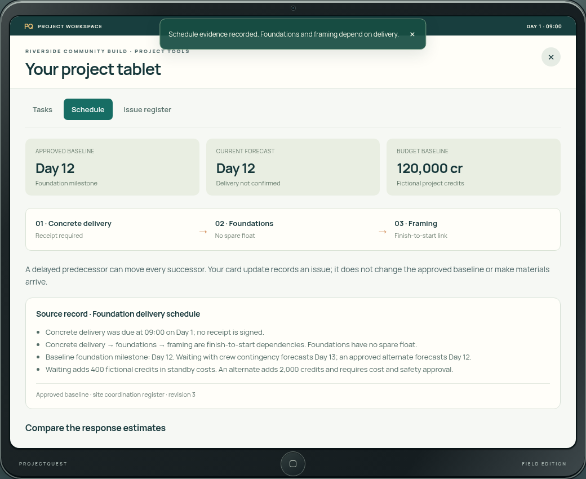
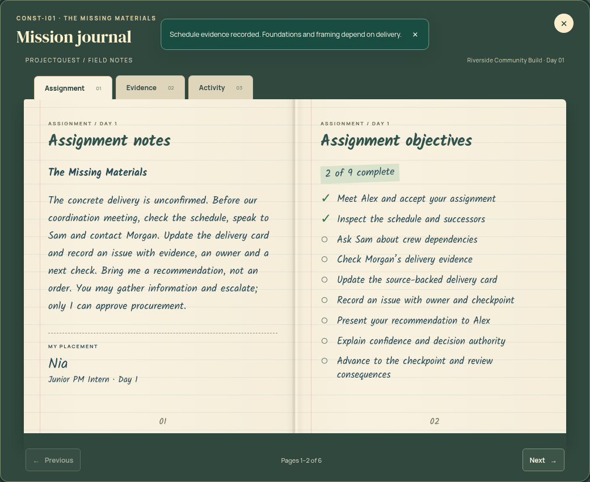

# Project tablet and field notebook

The tablet and notebook present live project information within the existing 3D workplace. Both chapters use the same device shells and the same keyboard/focus boundary as the rest of the game.

## Project tablet

Press **T** or choose Project tablet. The device has a graphite bezel, camera detail, in-game time, a fixed screen header and an independently scrolling tool area. Tabs operate the existing task/schedule/issue tools in Day 1 and source/dependency tools in Day 2. Their form validation, authority checks and saves remain canonical. The round physical home button puts the tablet away; Escape and the close button do the same. Focus returns to the control that opened it.

## Field notebook

Press **J** or choose Journal. The ruled, bound pages use self-hosted Kalam handwriting with cream paper, ink marks, a spine and page edges. Assignment shows the real briefing and live objective completion. Evidence includes every inspected source and its provenance. Activity contains the actual logged actions, with five entries per page. Previous/Next turn spreads; bookmarks jump to each section. Section tabs and page controls remain within reach while scrolling. Page turns change presentation state only.

The layout stacks paper pages on narrow screens, preserves larger text and high contrast, and supports reduced motion. [Portrait tablet](media/tools/portrait-tablet.png) and [portrait notebook](media/tools/portrait-journal.png) captures show the real 390px test run. Notifications in these captures are live game feedback from the immediately preceding schedule save.

Implementation: `Dialog.tsx` / `devices.css` own the shells and shared keyboard boundary; `MissionJournal.tsx` / `journal.css` own the book's state-derived spreads. Existing mission panels still own their real editable tools. Font provenance and SIL OFL terms are retained in `public/fonts`. See [verification.md](verification.md) for the completed checks.
